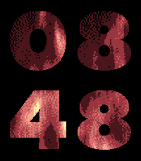
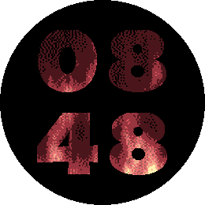

# Fireplace

Pebble watchface showing animated flames through the time digits.

|  |  |  |  |  |
|:--:|:--:|:--:|:--:|:--:|
| Basalt | Aplite, Diorite, Flint | Chalk | Emery | Gabbro |

The flames animate continuously, so this face uses more battery than a static one.

## Platforms

| Platform | Screen | Flames | Extras |
|----------|--------|--------|--------|
| Aplite, Diorite | 144x168 B&W | 1-bit | |
| Flint | 144x168 B&W | 1-bit | Fireplace crackle |
| Basalt | 144x168 color | color | |
| Chalk | 180x180 round color | color | |
| Emery | 200x228 color | color | Fireplace crackle, flickering backlight |
| Gabbro | 260x260 round color | color | |

The digits and flames recenter above a Timeline Quick View. The animation and crackle pause
while a notification covers the face. The crackle stays silent during Quiet Time and when the
watch's speaker is muted. Its loudness is `VOLUME` in `src/c/crackle.c`.

On Emery the backlight stays on and flickers in the colors of the flames, following the brightness
of each animation frame. This overrides the watch's backlight timeout and ambient light sensor for
as long as the face is showing, and drains the battery much faster. It can be turned off in settings.

## Settings

The phone settings page only offers what the watch supports:

| Setting | Platforms | Default |
|---------|-----------|---------|
| Flickering backlight | Emery | On |
| Crackling sound | Emery, Flint | On |

Other watches show a note that there's nothing to configure, and don't include any settings code.

## Building

```
pebble build
pebble install --emulator emery
```

## Assets

`resources/digits`, `resources/flames` and the menu icons are generated from `tools/source`
(the Futura font and the original fire animation). To change or regenerate them, run:

```
python3 tools/build_assets.py
```

The digit sizes and flame sizes in that script must match the constants at the top of `src/c/main.c`.
